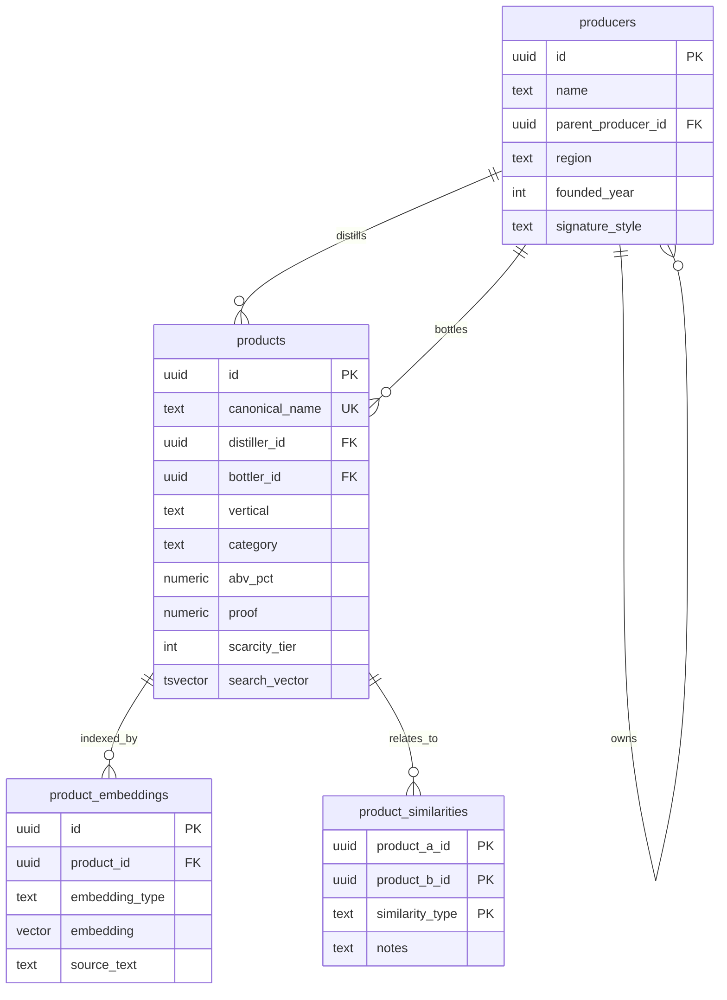

# Database Schema

Structural reference for BuzzBuddy's knowledge base. Reasoning behind these
decisions lives in the ADRs — see [ADR-0001](adr/0001-database-and-auth.md)
(platform), [ADR-0005](adr/0005-embedding-strategy.md) (embeddings),
[ADR-0006](adr/0006-knowledge-base-curation.md) (curation), and
[ADR-0011](adr/0011-product-schema-structure.md) (structure).

> **Status:** Implemented. `supabase/migrations/` is authoritative for exact
> DDL — it carries the full field-level rationale as inline comments. This
> document covers structure, purpose, and conventions: the parts that change
> far less often. If the two disagree, the migration is right.

---

## Overview



> **The diagram shows key and identifying columns only, not every field.**
> `products` alone has ~35 columns; drawing them all would make the diagram
> unreadable. Full column definitions for every table are in the sections
> below — treat those as authoritative, not the diagram.

Four tables, each with a distinct job:

| Table | Role |
|---|---|
| `products` | **The knowledge.** Everything the agent actually reads and reasons over. |
| `product_embeddings` | **The search index.** How the right products get found. Never shown to the LLM. |
| `producers` | Distilleries, breweries, wineries. Referenced twice per product — who distilled it, who sells it. |
| `product_similarities` | **Curated market-role knowledge.** A non-vector retrieval path for relationships embeddings can't derive. |

User-facing tables (`user_collections`, `user_preferences`) are deferred to
v1.0 and intentionally absent.

---

## `producers`

Distilleries, breweries, and wineries in one table — the fields are
identical across verticals, and some companies genuinely span them
(Constellation Brands owns wine, beer, and spirits). No `producer_type`
column: it's derivable from the products that reference the row, and
forcing a single value would misrepresent multi-category companies.

| Column | Type | Notes |
|---|---|---|
| `id` | `UUID` | PK |
| `name` | `TEXT NOT NULL` | |
| `parent_producer_id` | `UUID` | Self-reference. Sazerac → Buffalo Trace. Enables "everything Sazerac owns." |
| `region` | `TEXT` | |
| `country` | `TEXT` | |
| `founded_year` | `INTEGER` | |
| `description` | `TEXT` | Full prose — history and background. Fetched on demand, too long to attach to every search result. |
| `signature_style` | `TEXT` | One line — house style, short enough to inject alongside every product result. "Known for wheated bourbons." |
| `created_at` | `TIMESTAMPTZ DEFAULT now()` | Set once on insert |
| `updated_at` | `TIMESTAMPTZ DEFAULT now()` | Requires a trigger — see below |

---

## `products`

One table for all verticals. Vertical-specific columns are nullable —
`proof`, `age_years`, and `age_statement` don't apply to beer or wine, and
beer's IBU / wine's vintage will join them as nullable columns later. See
[ADR-0011](adr/0011-product-schema-structure.md) for why this beats
per-vertical tables.

### Identity

| Column | Type | Notes |
|---|---|---|
| `id` | `UUID` | PK |
| `canonical_name` | `TEXT NOT NULL UNIQUE` | "Eagle Rare 10 Year". Unique — duplicates would degrade `resolve_bottle()`. Store picks and limited releases need distinct names. |
| `brand` | `TEXT` | "Eagle Rare" |
| `expression` | `TEXT` | "10 Year", "Single Barrel", "Barrel Proof" |
| `full_name` | `TEXT` | Full label text |

### Producer and origin

| Column | Type | Notes |
|---|---|---|
| `distiller_id` | `UUID → producers(id)` | Where it was physically distilled |
| `bottler_id` | `UUID → producers(id)` | Who bottles and sells it. See convention below. |
| `region` | `TEXT` | "Kentucky" |
| `country` | `TEXT` | "USA" |

### Classification

| Column | Type | Notes |
|---|---|---|
| `vertical` | `TEXT NOT NULL` | `whiskey` \| `beer` \| `wine`. The tool-boundary filter. |
| `category` | `TEXT NOT NULL` | Within vertical: `bourbon`, `rye`, `scotch` … |
| `subcategory` | `TEXT` | Primary class only: `straight bourbon`, `single malt`, `blended`. One value — see convention below. Unconstrained; vocabulary emerges during curation. |

### Spec sheet

| Column | Type | Notes |
|---|---|---|
| `abv_pct` | `NUMERIC` | **Canonical.** Universal across all verticals. |
| `proof` | `NUMERIC GENERATED ALWAYS AS (abv_pct * 2) STORED` | Derived — US proof is exactly 2× ABV. Never written directly. |
| `age_years` | `NUMERIC` | Nullable for NAS bottles |
| `age_statement` | `TEXT` | "10 Year", "No Age Statement" |

### Tags

| Column | Type | Notes |
|---|---|---|
| `flavor_profile` | `TEXT[]` | `{sweet, vanilla, caramel, oak, spice}`. Open vocabulary. |
| `style_tags` | `TEXT[]` | `{wheated, high-rye, single-barrel, bottled-in-bond}`. Attributes, not classification — see convention below. Open vocabulary. |

No `high-proof` tag: that's redundant with the `proof` column, and a numeric
comparison (`WHERE proof >= 100`) is more precise than a fuzzy bucket.

### Pricing

Six columns rather than one, because the gaps between them carry the
recommendation. Weller 12 at $35 MSRP is an extraordinary find; at $150
shelf it's still good; at $300 secondary it's a different decision.

| Column | Type | Notes |
|---|---|---|
| `msrp_usd` | `NUMERIC` | |
| `typical_retail_low_usd` | `NUMERIC` | |
| `typical_retail_high_usd` | `NUMERIC` | |
| `secondary_market_low_usd` | `NUMERIC` | Nullable — populate for allocated bottles only |
| `secondary_market_high_usd` | `NUMERIC` | Nullable |
| `pricing_notes` | `TEXT` | "MSRP $40 but typically $80–150 due to allocation" |

### Releases

Per-batch detail for bottles sold in distinct batches — barrel proof lines,
annual limited editions. The product-level columns describe the bottle in
general; `releases` records how individual batches differ from it. NULL means
no releases recorded, the normal case for a non-batched bottle.

| Column | Type | Notes |
|---|---|---|
| `releases` | `JSONB` | Array, one object per release. Guideline shape below; keys are not validated, so new ones need no migration |

```json
[
  {
    "laser_code": "L23182",
    "batch": "Batch 3",
    "year": 2023,
    "proof": 114.8,
    "msrp_usd": 70,
    "notes": "First release after the age statement returned"
  }
]
```

Not embedded: batch-level detail adds noise to product-level similarity, and
the agent reads it from the row once retrieval has found the product.

### Availability

| Column | Type | Notes |
|---|---|---|
| `availability` | `TEXT` | `widely_available` \| `regional` \| `allocated` \| `discontinued`. The *reason* something is hard to get. |
| `scarcity_tier` | `INTEGER` | 0–5. The *intensity*. See rubric below. |

Constrained loosely: `CHECK (availability <> 'widely_available' OR scarcity_tier = 0)`.
Deliberately permits `discontinued` or `regional` bottles to carry a high
tier — a discontinued cult bottle is genuinely hard to find.

### Descriptive (drives semantic search)

| Column | Type | Target length |
|---|---|---|
| `description` | `TEXT` | 100–300 words |
| `tasting_notes` | `TEXT` | 50–150 words |
| `community_sentiment` | `TEXT` | 100–200 words |

`community_sentiment` is the highest-value field in the schema — see
[ADR-0006](adr/0006-knowledge-base-curation.md). Lengths are editorial
guidance, not constraints.

### Ratings

| Column | Type | Notes |
|---|---|---|
| `whiskey_advocate_score` | `INTEGER` | Nullable |
| `distiller_score` | `NUMERIC` | Nullable — manually captured during top-tier curation only |
| `independent_review_scores` | `JSONB` | Flexible bag for future sources without schema churn |

### Search and metadata

| Column | Type | Notes |
|---|---|---|
| `search_vector` | `tsvector GENERATED … STORED` | Auto-maintained from `canonical_name`, `description`, `tasting_notes`, `community_sentiment`. Keyword half of hybrid retrieval. |
| `data_quality` | `TEXT` | `high` \| `medium` \| `low`. Lets the agent caveat its own confidence. |
| `notes` | `TEXT` | Internal curation notes — not for user-facing output |
| `created_at` | `TIMESTAMPTZ DEFAULT now()` | Set once on insert |
| `updated_at` | `TIMESTAMPTZ DEFAULT now()` | Requires a trigger — see below |

---

## `product_embeddings`

Three embeddings per product, generated from programmatically-produced
natural language (never serialized JSON — see
[ADR-0005](adr/0005-embedding-strategy.md)).

| Column | Type | Notes |
|---|---|---|
| `id` | `UUID` | PK |
| `product_id` | `UUID NOT NULL → products(id) ON DELETE CASCADE` | |
| `embedding_type` | `TEXT NOT NULL` | `full_profile` \| `tasting_notes` \| `community_sentiment` |
| `embedding` | `VECTOR(1536)` | OpenAI `text-embedding-3-large`, requested at `dimensions=1536` (native is 3072) |
| `source_text` | `TEXT` | Exactly what was embedded — for debugging retrieval and clean re-embedding on model change |
| `created_at` | `TIMESTAMPTZ` | |

`UNIQUE (product_id, embedding_type)` — one embedding of each type per product.

All three types are generated from day one; retrieval initially queries
`full_profile` only, with query-intent-based type selection layered in later.
This avoids a backfill across the whole KB.

**No HNSW index initially.** At ~1,500 vectors, exact search returns in
single-digit milliseconds with perfect recall. Adding HNSW later is a
one-line `CREATE INDEX` with no schema or query changes — and deferring it
means the exact results serve as ground truth for measuring recall loss when
it is added.

---

## `product_similarities`

Curated market-role knowledge. This table exists specifically because
embeddings *cannot* derive these relationships — two bottles can be sensible
substitutes in a purchase decision without tasting anything alike.

| Column | Type | Notes |
|---|---|---|
| `product_a_id` | `UUID NOT NULL → products(id) ON DELETE CASCADE` | |
| `product_b_id` | `UUID NOT NULL → products(id) ON DELETE CASCADE` | |
| `similarity_type` | `TEXT NOT NULL` | `step_up` \| `alternative` |
| `notes` | `TEXT` | Why this relationship exists |
| `created_at` | `TIMESTAMPTZ` | |

`PRIMARY KEY (product_a_id, product_b_id, similarity_type)` and
`CHECK (product_a_id <> product_b_id)`.

Target ~50–100 relationships across top bottles. Entirely manual — there is
no automation path.

---

## Conventions

### Classification: `subcategory` vs `style_tags`

**`subcategory` answers "what kind of thing is this?" — exactly one answer.
`style_tags` answers "what attributes does it have?" — as many as apply.**

```
Henry McKenna Single Barrel Bottled-in-Bond
  vertical:    whiskey
  category:    bourbon
  subcategory: straight bourbon
  style_tags:  {single-barrel, bottled-in-bond, high-rye}
```

A tempting alternative rule — *subcategory = what's printed on the label* —
doesn't work, because label designations stack. The bottle above carries
three of them, and `subcategory` is a single column.

The taxonomic-slot framing also travels better across verticals. Wine and
beer have genuinely hierarchical single-value taxonomies (`red` → `cabernet
sauvignon`, `IPA` → `New England IPA`). Whiskey is the awkward vertical,
because its descriptors are multi-dimensional — grain bill × proof × barrel
treatment × batching method — rather than hierarchical. One taxonomic slot
plus an attribute array handles both shapes.

**Why `style_tags` earns its place:** grain-character tags like `wheated` and
`high-rye` are not derivable from anything else in the schema. Mash bill
percentage columns were deliberately excluded ([ADR-0006](adr/0006-knowledge-base-curation.md))
because exact recipes are trade secrets and community figures are guesses —
so categorical grain character is the only structured record of it. It isn't
on the label either; "wheated" is enthusiast vocabulary for a real,
decision-relevant property.

Note the asymmetry in verifiability: `bottled-in-bond` is checkable by
reading the bottle, while `high-rye` is a judgment call (is 18% rye "high"?).
That's a curation-consistency problem, not a schema one — see the curation
rules note under Open Items.

### Similarity direction

**`similarity_type` describes what B is, relative to A.**

`(wild_turkey_101, buffalo_trace, 'step_up')` reads *"Buffalo Trace is a step
up from Wild Turkey 101."*

`step_down` is **never stored** — it's the same row read backwards:

```sql
-- get_related_bottles(product_id)
SELECT product_b_id AS related, similarity_type AS relation
FROM product_similarities WHERE product_a_id = $1
UNION ALL
SELECT product_a_id AS related,
       CASE similarity_type WHEN 'step_up' THEN 'step_down'
                            ELSE similarity_type END AS relation
FROM product_similarities WHERE product_b_id = $1;
```

One fact, one row, no way for a step-up and its step-down to disagree.
`alternative` is symmetric — stored in whichever direction it was entered,
found from either side.

### `bottler_id` semantics

| State | Meaning |
|---|---|
| `bottler_id = distiller_id` | Not sourced — distilled and bottled by the same company |
| `bottler_id <> distiller_id` | **Sourced.** Distilled by one company, sold by another. |
| `bottler_id IS NULL` | Not yet researched, or genuinely contested |

Sourced whiskey is common in American bourbon, and identifying it enables a
genuinely useful recommendation: two differently-priced bottles may be
substantially the same liquid.

### Cross-vertical isolation

Nothing about the single-table design prevents a wine query from returning
whiskey — tasting vocabulary overlaps enough that cosine distance alone will
not separate them. Isolation comes from a **hard filter on `vertical`**,
enforced at the **tool boundary**: separate tools per vertical, each
hardcoding its own filter, so the model cannot omit a parameter it doesn't
control.

### Scarcity tier rubric

Consistency across 150+ bottles curated over weeks requires anchors, not
adjectives.

| Tier | Meaning | Anchors |
|---|---|---|
| 0 | Always on the shelf. No hunting. | Evan Williams Black, Wild Turkey 101 |
| 1 | Usually available; might need a second store. | Four Roses Small Batch, Old Forester 100 |
| 2 | Regularly around but not guaranteed; regional gaps. | Elijah Craig Barrel Proof |
| 3 | Genuinely allocated. Delivery-day knowledge or raffles. Findable a few times a year. | Blanton's, Weller Special Reserve |
| 4 | Hard allocation. Lottery-only in most markets. | Weller 12, Stagg |
| 5 | Effectively unobtainable at retail. Secondary only, for most people. | Pappy Van Winkle, BTAC |

Two caveats:

- **Anchors need verification.** Allocation patterns shift year to year.
  Calibrate against what's actually on shelves now.
- **Scarcity is regional.** This is a national approximation. Blanton's is
  meaningfully easier in some states than others. Per-region availability
  would require a data source that doesn't exist yet (crowdsourced sightings
  being the realistic path) — the global tier remains the default if that
  ever lands.

---

## `updated_at` triggers

Postgres has no built-in "touch this column on every UPDATE" behavior. A
column with `DEFAULT now()` is set on insert and then never changes again —
silently stale, which is worse than not having it. One shared function plus a
trigger per table:

```sql
CREATE OR REPLACE FUNCTION set_updated_at()
RETURNS TRIGGER AS $$
BEGIN
  NEW.updated_at = now();
  RETURN NEW;
END;
$$ LANGUAGE plpgsql;

CREATE TRIGGER producers_set_updated_at
  BEFORE UPDATE ON producers
  FOR EACH ROW EXECUTE FUNCTION set_updated_at();

CREATE TRIGGER products_set_updated_at
  BEFORE UPDATE ON products
  FOR EACH ROW EXECUTE FUNCTION set_updated_at();
```

Only `producers` and `products` need this. `product_embeddings` and
`product_similarities` carry `created_at` alone — rows there are written and
replaced rather than edited in place.

## Extensions and indexes

```sql
CREATE EXTENSION IF NOT EXISTS vector;    -- vector type, distance ops, HNSW
CREATE EXTENSION IF NOT EXISTS pg_trgm;   -- fuzzy name matching for resolve_bottle()
```

```sql
-- array containment filters
CREATE INDEX ON products USING GIN (style_tags);
CREATE INDEX ON products USING GIN (flavor_profile);

-- fuzzy name resolution
CREATE INDEX ON products USING GIN (canonical_name gin_trgm_ops);

-- keyword half of hybrid retrieval
CREATE INDEX ON products USING GIN (search_vector);

-- join and filter paths (Postgres does NOT auto-index foreign keys)
CREATE INDEX ON products (vertical, category);
CREATE INDEX ON product_similarities (product_b_id, similarity_type);
CREATE INDEX ON producers (parent_producer_id);
```

No separate index on `product_embeddings (product_id, embedding_type)` — the
`UNIQUE` constraint on those columns already creates exactly that btree index.

The similarities reverse index matters because of the direction convention —
the primary key serves forward lookups, but derived `step_down` queries read
`product_b_id`.

Postgres full-text search is not literally BM25; `ts_rank` uses a different
weighting scheme. Close enough for Reciprocal Rank Fusion, but worth not
mislabeling.

---

## Constrained vocabularies

Enforced with `CHECK (col IN (...))` rather than Postgres `ENUM` types.
Extending a CHECK is a drop-and-recreate in one migration; `ENUM` has no
`DROP VALUE` syntax at all, so removing or renaming requires creating a new
type and migrating the column. `category` is guaranteed to gain values.

| Column | Values |
|---|---|
| `products.vertical` | `whiskey`, `beer`, `wine` |
| `products.category` | `bourbon`, `rye`, `scotch`, … (extends with verticals) |
| `products.availability` | `widely_available`, `regional`, `allocated`, `discontinued` |
| `products.data_quality` | `high`, `medium`, `low` |
| `product_embeddings.embedding_type` | `full_profile`, `tasting_notes`, `community_sentiment` |
| `product_similarities.similarity_type` | `step_up`, `alternative` |

Not constrained: `subcategory`, `style_tags`, `flavor_profile` — open
vocabularies by design.

---

## Row-level security

All tables have RLS enabled with **no policies**. These tables are backend-only:
the FastAPI service reads and writes them using the Supabase service role key,
which bypasses RLS. The admin UI reaches them through JWT-protected backend
endpoints, not directly via the Supabase client.

No policies means anon and authenticated roles are denied everything — the
correct posture given no frontend path touches these tables. If that ever
changes, policies get added then.

---

## Open items

- **Curation rules and templates — needed before populating the KB.**
  Several fields require judgment calls that will drift across 150+ bottles
  curated over weeks unless the rules are written down and checked against.
  Known cases so far: the `scarcity_tier` anchors above; when a bottle
  qualifies as `wheated` or `high-rye`; what earns `high` vs `medium`
  `data_quality`; the register and required elements of
  `community_sentiment`; and how much uncertainty is tolerable before
  `bottler_id` stays `NULL`. This wants a curation guide plus a per-bottle
  template or checklist, built alongside the admin UI rather than after
  inconsistent entries accumulate.
- **Cross-encoder reranking** ([ADR-0005](adr/0005-embedding-strategy.md))
  is unresolved between Cohere and a BGE reranker. Application-layer, no
  schema impact.
